# 定制键盘工坊 Keycap Studio

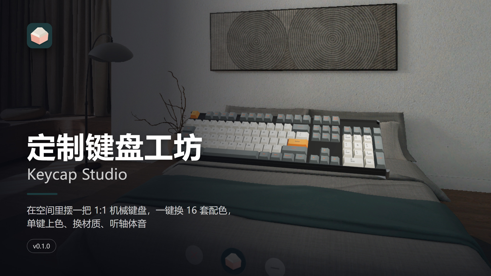

[中文](#中文) · [English](#english)

## 中文

在你的共享空间里摆一把 1:1 的机械键盘：87 / 104 键随手切，整区或单键上色，一键套用 16 套经典客制化配色，换图案、换材质、换轴体，按下去有行程、有轴体音。凑近看键帽的阶梯和刻字，满意了就存成方案、导出来发给朋友。PICO OS 6 空间应用（PICO Spatial SDK 6.1.9，Kotlin）。

- **配色**：16 套经典客制化配色（灵感来源 GMK 同名套装，社区近似色），点一张卡整把换掉；[随机一套]
- **调色盘**：按字母区 / 修饰键 / 点缀 / 空格 / 方向键 / 导航区 / 数字键区 / F 区 / 数字行 / 全部上色，色相环 + 明度 / 饱和度 + HEX；单键模式一个一个点；撤销 / 重做 50 步
- **图案**：纯色 / 渐变 / 主题图案（8 套程序生成，或导入自己的图片铺满整板）/ 侧刻 / 透光
- **材质与声音**：PBT 磨砂、ABS 亮面、透光 PC；OEM / Cherry 键高；五种轴体，4 mm 行程和真实录音；[试打一句]
- **方案**：保存 / 另存 / 载入 / 删除；导出方案卡 PNG 和 JSON，导入朋友的 JSON
- 中英双语，全部本机运行，不联网、不需要账号

| | |
|---|---|
| 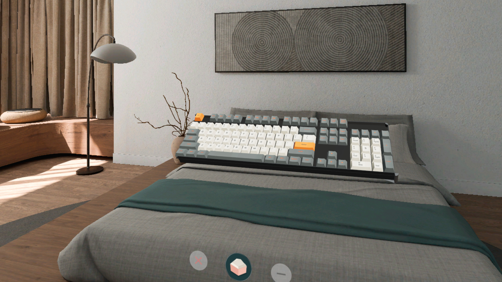 | 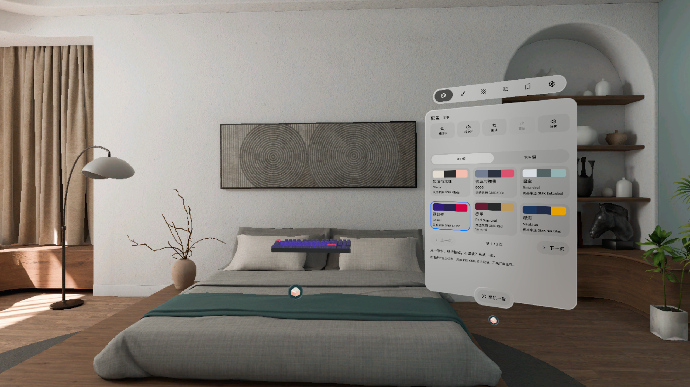 |
| 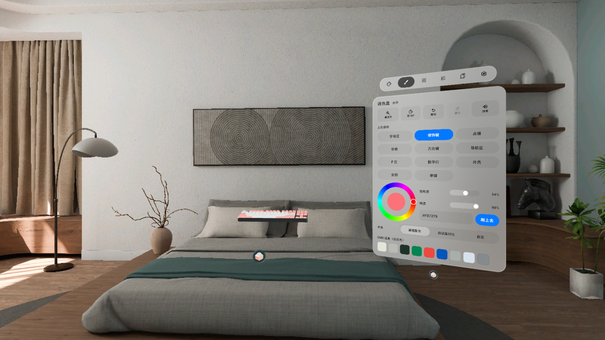 | 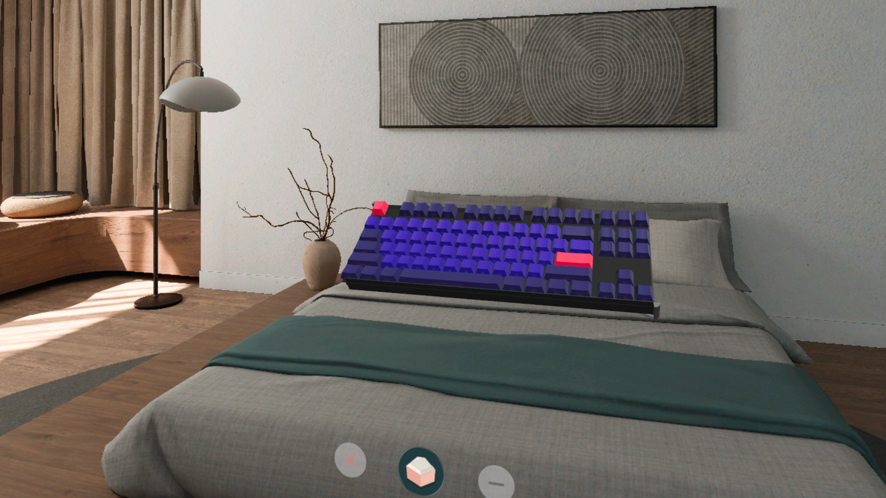 |
| 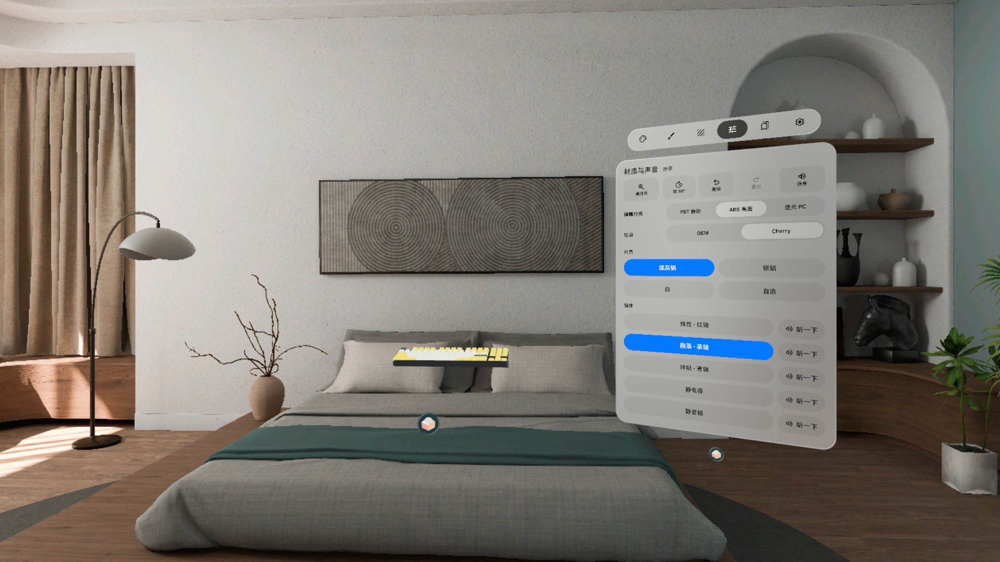 | 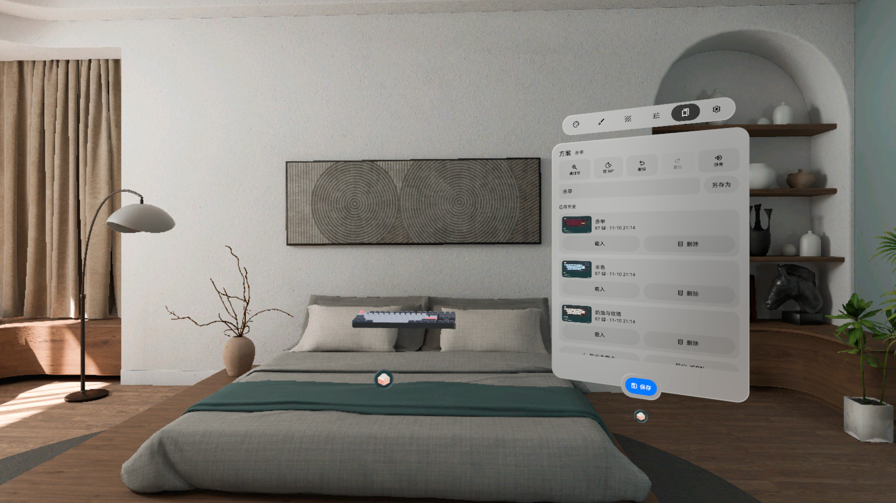 |

截图来自 PICO 模拟器（调试命令驱动状态），**不是真实手势录像**。

### 安装

[Release v0.1.0](https://github.com/kejing-dev/KeycapStudio/releases/tag/v0.1.0) 里的 `KeycapStudio-v0.1.0.apk` 是 `assembleRelease` 出的**未签名**包（给 Vibe Lab 上架用），不能直接 `adb install`。自己装请从源码出 debug 包：

```bash
./gradlew assembleDebug
adb install -r app/build/outputs/apk/debug/app-debug.apk
pico-cli app launch io.embodit.keycapstudio
```

构建细节见 [AGENTS.md](AGENTS.md)。

### 数据与许可

布局按 KLE 格式自写（ANSI 104 / TKL 87）；16 套配色的色值取自 keysim（MIT）；字体 Noto Sans / Noto Sans SC / JetBrains Mono（SIL OFL 1.1）；图标 Material Symbols（Apache-2.0）；轴体音 CC0。配色名注明「灵感来源 GMK ×」，是社区近似色，不是厂商色号。

## English

Put a 1:1 mechanical keyboard in your shared space. Switch between 87 and 104 keys, paint whole groups or single caps, apply 16 classic custom colorways in one tap, change patterns, materials and switches, and press keys with real travel and switch sound. Lean in to see the sculpted rows and legends, then save the scheme and export it for a friend. A PICO OS 6 spatial app (PICO Spatial SDK 6.1.9, Kotlin).

- **Colorways**: 16 classic colorways (inspired by the GMK sets of the same name, community approximations); tap a card to swap the whole board, or Random set
- **Palette**: paint alphas / modifiers / accents / space / arrows / nav cluster / numpad / F row / number row / everything with a hue ring, brightness, saturation and HEX; single-key mode; 50 steps of undo / redo
- **Patterns**: solid / gradient / themed pattern (8 generated, or your own image across the board) / side print / shine-through
- **Material & sound**: PBT matte, ABS gloss, clear PC; OEM or Cherry profile; five switches with 4 mm travel and real recordings; Try typing
- **Schemes**: save / save as / load / delete; export a PNG scheme card and JSON, import a friend's JSON
- Chinese and English, fully offline, no account

| | |
|---|---|
|  | 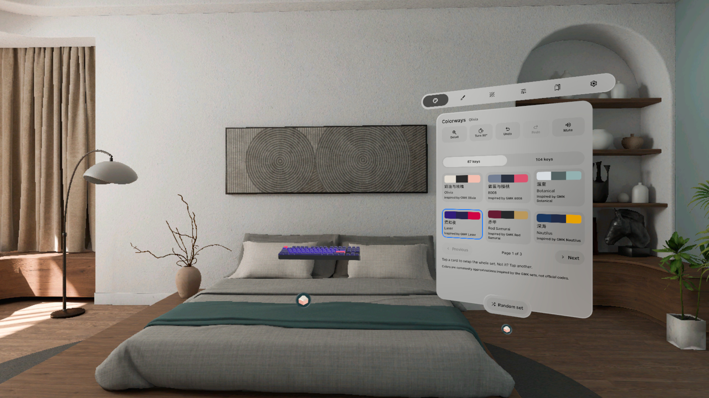 |
| 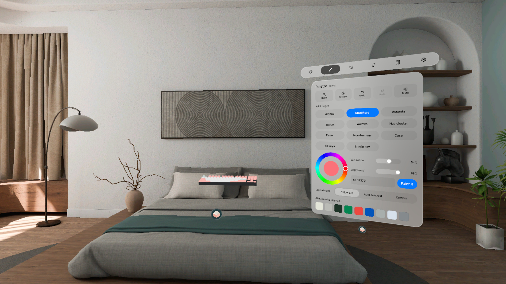 |  |
| 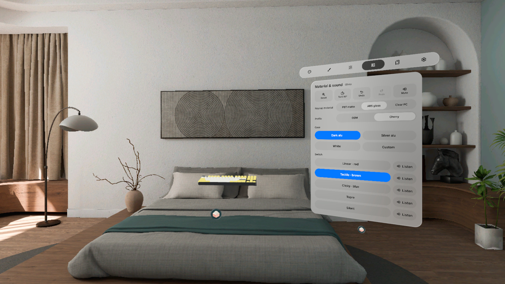 | 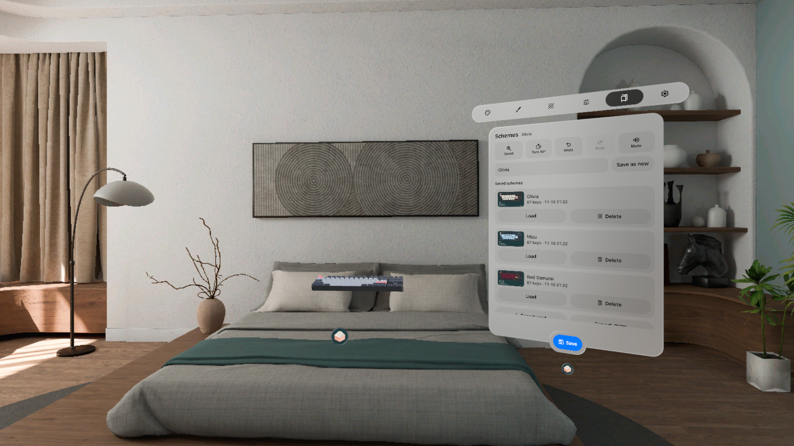 |

Screenshots are from the PICO emulator, driven by debug commands. **Not a recording of real hand input.**

### Install

`KeycapStudio-v0.1.0.apk` in [Release v0.1.0](https://github.com/kejing-dev/KeycapStudio/releases/tag/v0.1.0) is an **unsigned** `assembleRelease` build for store submission and cannot be installed with `adb install` as is. To try it yourself, build the debug APK:

```bash
./gradlew assembleDebug
adb install -r app/build/outputs/apk/debug/app-debug.apk
pico-cli app launch io.embodit.keycapstudio
```

Build details: [AGENTS.md](AGENTS.md).

### Data and licenses

Layouts are hand-written in KLE format (ANSI 104 / TKL 87); colorway values come from keysim (MIT); fonts Noto Sans / Noto Sans SC / JetBrains Mono (SIL OFL 1.1); icons Material Symbols (Apache-2.0); switch sounds CC0. Colorway names say "Inspired by GMK …": they are community approximations, not official colour codes.
